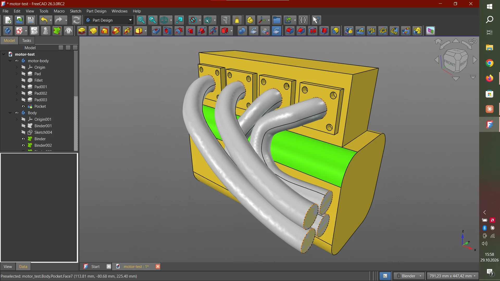
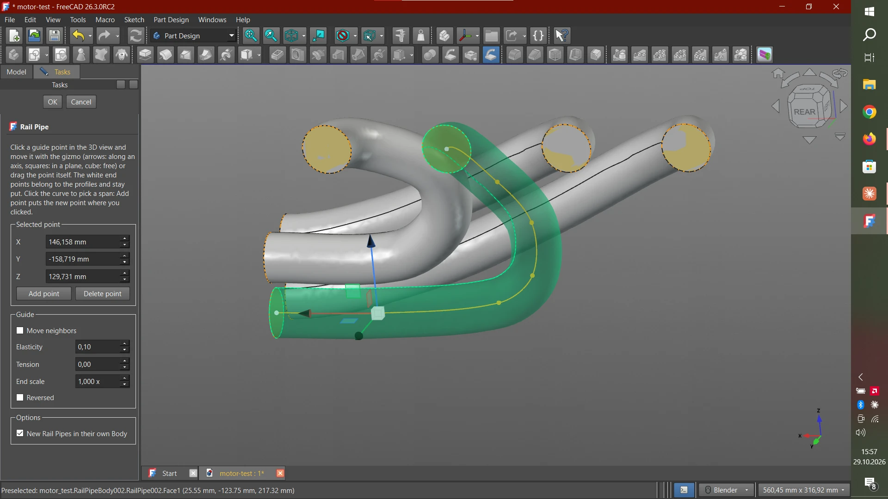
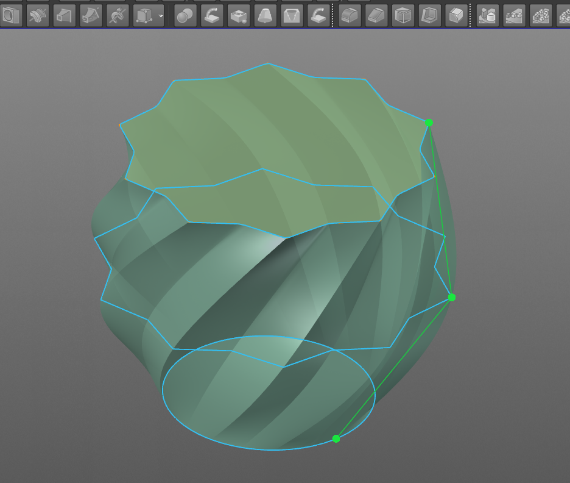
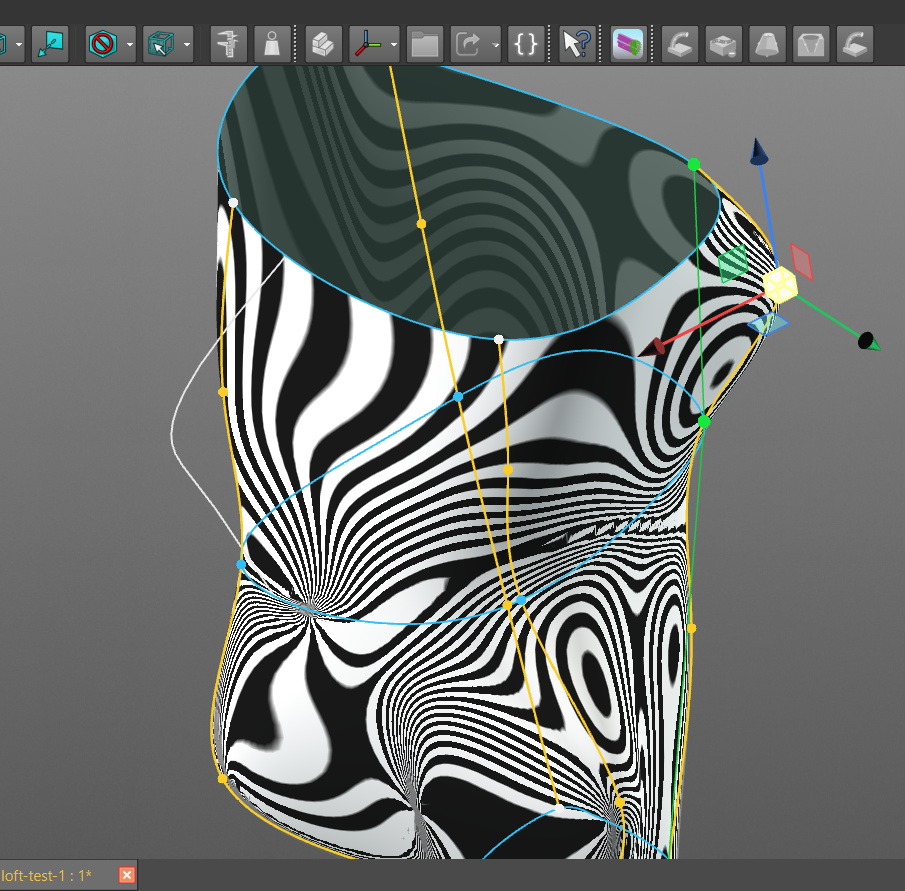
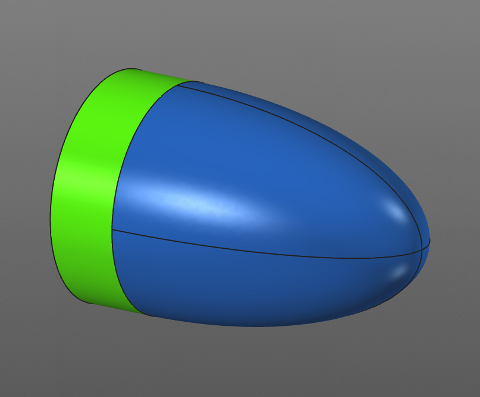
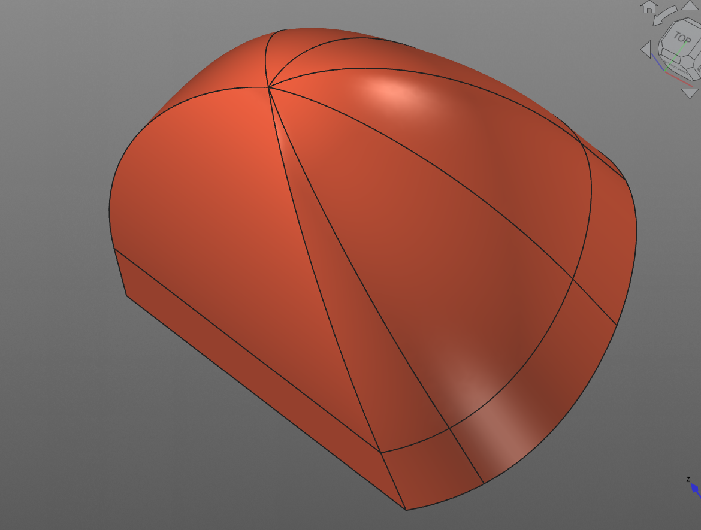
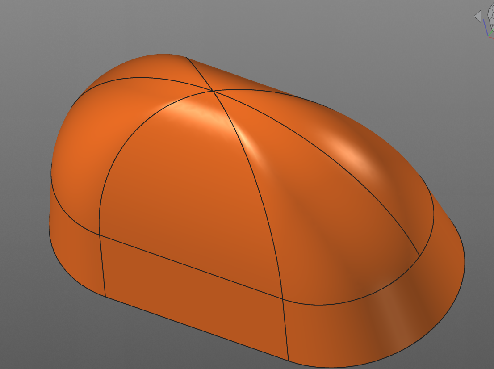

# Pimp My FreeCAD

Extra modeling tools for FreeCAD's **PartDesign** and **Part** workbenches. In a Body they are real PartDesign steps (like
Pad or Pocket): they recompute with the Body, later steps (fillets, pockets) build on them and the result exports to STEP.
Magic Pad is Pad and Pocket in one tool with a draggable arrow. Rail Pipe and Magic Loft also make standalone solids in the Part workbench. The tools show up in PartDesign's own
*Part Design Modeling Features* toolbar (next to Additive / Subtractive Pipe) and in a small *Pimp My FreeCAD* workbench.

Requires **FreeCAD 1.0 or newer** (developed on 26.3). No extra Python packages.

## Rail Pipe / Rail Groove

  
  

Sweeps a profile along a guide curve and adds it to the Body (**Rail Pipe**) or cuts it out (**Rail Groove**).

- **Profiles:** select one or two **flat faces**, **closed edges** (a circular edge or a closed flat loop) or
  **closed sketches** (click a sketch edge or pick the
  sketch in the tree). Two profiles: the start profile blends into the end profile. One profile: the pipe ends
  free; *EndScale* sizes the free end. An empty Body works too (the pipe becomes its first solid).
- **Guide curve:** leaves the start profile perpendicular and (with two profiles) enters the end profile
  perpendicular, passing through *GuidePoints*. *Tension* (0 smooth .. 1 straight between points) tightens it;
  uneven point spacing does not make it bulge. *Reversed* flips the start direction.
- **Edit on screen:** double-click the feature. The previous solid stays visible and the pipe is drawn as a light
  green (pipe) or red (groove) translucent mesh around the yellow guide curve. No solid is computed while you
  edit, so dragging stays fluid (~20 ms per step); the real, smooth pipe is computed once when you press **OK**.
  - Click a yellow point and move it with the **Move gizmo** (arrows: along X / Y / Z, squares: in a plane, cube:
    in the screen plane) or drag the point itself. The white end points belong to the profiles and stay put.
  - Click the curve to pick a span: *Add point* puts a point exactly where you clicked. *Delete point* removes the
    selected one.
  - *Move neighbors*: the guide follows the dragged point like a cable; *Elasticity* 0 = chain (lengths kept) ..
    1 = rubber band.
  - The task panel also has the selected point's X / Y / Z, *Tension*, *End scale* and *Reversed*.
  - **OK** computes the pipe and keeps the changes as one undo step, **Cancel** reverts them.
  - *Shell* (under *Options*) makes the pipe hollow with open ends and the given *Wall thickness*. Use this
    instead of PartDesign Thickness, which is unreliable on swept surfaces.
- **Several pipes, faster:** with *Rail Pipe in its own Body* switched on (checkable button next to Rail Groove,
  also under *Options* in the task panel) each new pipe gets its own Body; its profiles are bound with
  SubShapeBinders, so the pipes don't recompute and fuse together on every change. Fuse the Bodies later if you
  need one solid.
- **Part workbench:** the Rail Pipe button is at the end of the Part Tools toolbar. There the pipe is a standalone solid
  outside any Body (profiles can be faces or sketches of any object, read in global coordinates); add it to or
  cut it from a shape with Part Fuse / Cut. Editing on screen works the same way.

Limits of this first version: the profile is the start face's / sketch's outer outline (holes are ignored), no
scale per guide point yet.

## Magic Loft / Magic Loft Cut

  
  

A clean loft through two or more closed profiles, added to the Body (**Magic Loft**) or cut out (**Magic Loft Cut**).
It builds one low-pole surface instead of a dense sweep: fast, and made to take PartDesign Thickness and export to STEP.

- **Profiles:** select flat faces, closed sketches, Binders or closed edge loops; a loop may be **non-planar** (a parting
  line, for example). They are ordered automatically; *Up* / *Down* change the order. Seams and corners are matched
  automatically. For a section in the middle, select one more profile.
- **Guides:** open sketches or curves in the selection become guides, and each separate open chain in a sketch is one
  guide. A guide must touch every profile, otherwise the feature reports which one is how far away. With
  **Draw ready guides** on, automatic guides appear instead (4 by default, *Number of guides* changes it and rebuilds
  them); the selected guides stay in the list, unused, until you switch it off.
- **Start / end constraints:** *Free*, *Normal to profile* or *Tangent to face* per end, with a strength. An end on a
  solid's face starts as Normal, a sketch end as Free.
- **Edit on screen:** double-click the feature (the panel also opens right after creating one). Move the yellow points
  of the automatic guides with the Move gizmo, add and delete points, use *Move neighbors* (one point at a time).
  Ctrl+click selects several points, which move and delete together. **Mirror move** (two points selected): the first
  selected point is the base, the other snaps to its mirror about the loft axis in a plane perpendicular to the view, and
  from then on they move symmetrically; changing the selection or rotating the view turns it off. After a move the points
  of a guide are spread along it by their distances (chord length), so symmetric points give symmetric guides. Drag the green **connector** dots to fix a twist;
  they snap to edge ends and midpoints (hidden with selected guides, which set the matching themselves). While dragging you see a
  light mesh; on release the real surface; *Zebra* shows reflection stripes on it. The solid is computed on **OK**.
- **Guide influence:** how far a guide acts sideways. A larger value lifts a broader area instead of a narrow ridge
  (new features start at 2 x; features saved earlier keep 1 x, so their shape doesn't change until you raise it).
- **Part workbench:** a standalone solid outside any Body. *New Magic Lofts in their own Body* in the panel works like Rail Pipe's own
  option, but is set separately.

Limits: a **corner-to-round** transition (hexagon to circle) gets no wall from PartDesign Thickness and no error from it;
the feature warns about it. Cut the inside with a Magic Loft Cut from inset profiles instead. Close loft, a centerline,
curvature (G2) ends and open profiles are not available.

**Section smoothing:** a line-to-arc joint is tangent, but its curvature jumps, and the one-piece surface ripples around it (Zebra
shows this as corners in the stripes). *Section smoothing* in the panel filters such a profile, up to the deviation you set. At 0 the
sketch is followed exactly. Circles, single curves and profiles with sharp corners do not change.

## Magic Pad

Pad and Pocket in one tool. Select a closed sketch (holes and several separate regions are fine) or a flat face of a
Body and press **Magic Pad**. Pull the arrow out of the solid to add material, push it into the solid to cut: the preview
is green or red and changes colour as it crosses zero. **Double-click the arrow** to flip the direction. Click the orange
value next to the arrow to type a length; the panel fields take FreeCAD expressions (fx).

- **Extent:** *Length*, *Two lengths*, *Symmetric*, *Through all*, *Up to body*, *Up to first face*, *Up to last face*,
  *Up to face* and *Up to shape*. For the last two press *Select...* and click the face or solid in the 3D view.
- **Up to body** stops every point where it first meets the Body, so a pad from a sketch to a hollow tube, onto a seam or
  with a profile wider than the target works. The part of the profile that misses is cut off or goes to *Length*.
  *Up to shape* does the same with another solid or Body.
- **Up to face** extends the chosen face: a plane without limit, a cylinder or cone along its axis, a sphere or torus to
  the full surface. *Up to first face* finds the first face hit, *Up to last face* goes through the Body to where it
  leaves it last.
- **Operation:** *Auto* adds or cuts by direction; choose *Add* or *Cut* when the direction does not tell it right.
- **Taper and twist** work in every mode (twist around the profile centre or the sketch origin, optional ease in / out).
- **Several faces:** select neighbouring flat faces (Ctrl) to push or pull them together; each moves along its own normal
  and the corners close sharp. *Side walls* follow the neighbouring faces or stand perpendicular like a Pad.
- **Direction:** face normal, the average of the selected faces, or a custom straight edge, flat face or datum axis.
- **Part workbench:** outside a Body, Magic Pad makes only the pulled solid, like Extrude; add or cut it with Part Fuse /
  Cut. The solid of the selected face is its *Reference* (not changed): the outward side and the Up to modes use it.
- **Fast:** while you drag there is no boolean, only the volume to add or cut; the lines where it meets the Body appear
  when you release the arrow. The solid is computed on **OK**, one undo step.

Limits: twist and taper rebuild the side faces, so turning them on or off can break fillets and sketches attached to
those faces. The boolean still runs in FreeCAD's process; a separate safe worker is planned.

## Dome

  
  
  

Raises a flat face into a cap that runs tangent into the faces around it, like the Dome command in other CAD systems.
Select one flat face of a Body and press **Dome**. The panel has *Height*, *Reversed* (cut into the solid) and *Tangent to
steep walls*, and the real solid updates as you change them. **OK** keeps it as one undo step; **Cancel** reverts it and
removes a new feature. The panel shows the measured tangent error.

- **Walls all around** (a plain or tapered Pad, a chamfer, a cylinder end): the dome starts along the walls at their own
  slope and rises to the top like a bullet, with an exact height. The error is 0 degrees on vertical walls, cones and flat
  chamfers, and about 0.01 degrees on a 12 degree tapered Pad with a curved outline. Sharp corners run up to the top as
  ridges. It needs every neighbour at least 30 degrees from the face, an outline fully visible from its centre and no holes.
  With *Tangent to steep walls* off you get a smooth bump instead, with a free slope at the walls.
- **Filleted top edges:** the neighbour is horizontal, so the surface starts flat and rises in a gentle S (under 0.01
  degrees). Curved, concave and sharp-cornered outlines and faces with holes work; the dome returns to the face level at
  every hole.
- **Long, sharp outlines** (a wing section): instead of one top point the dome follows a curved ridge along the middle
  of the outline, arched across and along, tangent to the walls and without folds; each pointed end is closed by one cap
  patch. Regular outlines (circle, slot, rounded rectangle) keep the classic single-top dome.

Limits:
- **Mixed edges and holes next to steep walls:** when only some neighbours are steep, or the face has a hole, those edges
  are not tangent. The edge stays sharp and the panel counts it.
- **Too tall on leaning walls:** when the walls would pass the centre before the top, the dome falls back to the smooth bump.
  On a chamfered 80 x 50 top at 60 mm that is 3 degrees off; on a tapered Pad at 400 mm the edges are not tangent.
- **Tapered Pads and STEP:** a tapered Pad with a curved outline came back from STEP with 3 of its 10 faces and no solid,
  with or without a dome. The tapered Pad itself causes this; check the export.
- **Filleted curved edges:** the edge between the dome and its neighbour can fail OCCT's strict BOP check, although the solid
  is valid and exports to STEP. Booleans away from the rim worked in every test.
- **Thickness:** PartDesign Thickness works on smooth outlines. It failed or left the part unchanged on outlines with sharp
  corners.
- **Collisions:** a smooth bump that runs into another part of the solid falls back to a real boolean, which takes seconds.
- **Not available:** a peak moved off-centre with a point, and domes on curved faces.

## Body Sweep / Body Sweep Cut *(experimental)*

Sweeps a **solid tool** (any Body or Part solid) along a path and cuts one or more solids with the volume it sweeps, like
SolidWorks' *Sweep Cut* with a body. Select the tool, the path (edges, a wire or a sketch) and the solids to cut, then press the
button. A PartDesign Body gets a light *Body Sweep Cut* step, other solids a Part Cut.

- **Orientation:** *Follow path* turns the tool with the path without twisting (rotation-minimizing frame, so vertical and 3D
  paths and helices work); *World Z up* keeps it upright. **Twist** goes from -360 to 360 degrees.
- **Method:** *Ray-traced* (default) builds the swept envelope without booleans of many copies: sections along the path, and
  start / end caps made from the faces hidden from the first / last section plane. It also handles non-convex tools (L, T,
  hourglass). If it fails it falls back to the exact method, so most shapes finish; if none works, a message says the shape is
  outside the tool's limits. *Exact* is slower (minutes) and for convex tools. It runs in a separate process: FreeCAD stays
  responsive and *Stop* ends it.
- **Offset:** clearance. The swept volume grows by this much on every side, so a channel can be wider than the part that runs
  through it (Round or Sharp corners; negative shrinks).
- Experimental: rings with through-holes and very thin or odd shapes may fall back to a coarser result or fail. Cylinders, boxes
  and hourglass-like tools are the tested cases. Needs scipy and shapely.

## Matcap

The *Matcap* drop-down button shows Part and PartDesign shapes in a Clay, Plastic, Black plastic, Ceramic or Metal look, or turns
the look off. It is display only: the document does not change and STEP export is not affected. The choice comes back after a
restart. A matcap replaces the object's own colour; selected and preselected faces still show FreeCAD's highlight colours.
Meshes are not included.

*Matcap with FreeCAD lights* (a check button next to it) lights the matcap with FreeCAD's own headlight, backlight and fill
light (direction, colour, intensity, on / off, from Preferences > Display > 3D View) instead of the matcap's studio light.
A change in those settings updates the look at once. Zebra, Metal and Draft analysis are not affected.

The same button has two analysis views. *Zebra* shows reflection stripes, which break at a kink. *Draft analysis* opens a small
window for the pull direction and minimum draft, and colours faces by their angle: green has enough draft, yellow too little, red
is an undercut.

## STEP check

Select one or more shapes and press *STEP check*. The window reports whether each is valid and closed, its largest tolerance, very
short edges, and what comes back after a test export: solids, faces, edges, volume and bounding box. The shapes do not change, and the
temporary STEP file is deleted. A strict-check warning can appear on a sound solid that still exports correctly.

## Installation

**Addon Manager (custom repository)**
1. *Edit → Preferences → Addon Manager Options → Custom repositories*, add
   `https://github.com/sedatkrn/PimpMyFreeCAD` with branch `main`.
2. Find **Pimp My FreeCAD**, install, restart FreeCAD.

**Manual:** clone or unzip this repository into FreeCAD's user `Mod` folder and restart FreeCAD:
- Windows: `%APPDATA%\FreeCAD\<version>\Mod\PimpMyFreeCAD`
- Linux: `~/.local/share/FreeCAD/<version>/Mod/PimpMyFreeCAD`
- macOS: `~/Library/Application Support/FreeCAD/<version>/Mod/PimpMyFreeCAD`

## Language

English by default, **Turkish** built in. `auto` (the default) follows FreeCAD's language; set
`Preferences/Mod/PimpMyPartDesign/Language` to `en` or `tr` to force one.

## For developers

[docs/OCCT_NOTES.md](docs/OCCT_NOTES.md) collects the OCCT / FreeCAD lessons behind Rail Pipe (sweep frames,
continuity, booleans, fast on-screen previews). Rail Pipe started in
[FcSubDModelerWB](https://github.com/sedatkrn/FcSubDModelerWB), where its guide curve mirrors the SubD modeler's
Rail bridge.

## License

MIT — see [LICENSE](LICENSE). Code comments are mostly in Turkish (the author's language); the user interface and
documentation are in English.

---

### Türkçe

FreeCAD **PartDesign** ve **Part** için ek araçlar. Body içinde Pad / Pocket gibi gerçek bir adım olarak çalışırlar;
araçlar PartDesign'ın *Part Design Modeling Features* araç çubuğunda ve küçük bir *Pimp My FreeCAD*
workbench'inde görünür.

**Rail Pipe / Rail Groove:** bir ya da iki profil (Body'nin düz yüzü ya da kapalı sketch) seçip düğmeye basın.
Profil, yüzlerden dik çıkan bir kılavuz eğri boyunca süpürülür ve Body'ye eklenir (Pipe) ya da oyulur (Groove).
Özelliğe çift tıklayınca kılavuz ekranda düzenlenir: sarı noktayı gizmo ile ya da doğrudan sürükleyin, eğriye
tıklayıp *Nokta ekle* ile tam tıkladığınız yere nokta koyun, *Komşular da gelsin* ile kılavuz kablo gibi gelir.
Önizleme PartDesign'daki gibi yeşil / kırmızı yarı saydamdır. **Tamam** tek geri alma adımıdır, **İptal** geri alır.

**Sihirli Loft (Magic Loft) / Sihirli Loft Oyma:** iki ya da daha fazla kapalı profil seçin (düz yüz, kapalı sketch,
Binder, düzlemsel olmayabilen kapalı kenar halkası); seçimdeki açık eğriler rehber olur. *Hazır rehber çiz* açıkken
otomatik rehberler oluşur ve ekranda düzenlenir, seçili rehberler saklanır ama kullanılmaz. Uçlar *Serbest*, *Profile
dik* ya da *Yüzeye teğet* olabilir. Yeşil connector noktaları burulmayı düzeltir, *Zebra* yüzey kalitesini gösterir. İki nokta seçiliyken *Simetrik taşı*: ilk seçilen
nokta bazdır, öteki bakışa dik ve loft ekseninden geçen düzleme göre onun aynasına oturur, sonra ikisi simetrik hareket eder;
seçim değişince ya da görünüm döndürülünce kapanır.
Köşeliden yuvarlağa geçişte PartDesign Thickness et vermez; içini Sihirli Loft Oyma ile boşaltın.

**Kesit yumuşatma:** doğru-yay birleşimi teğettir ama eğriliği bir anda değişir; tek parça yüzey orada dalgalanır (Zebra'da şeritlerde
köşe olarak görünür). Paneldeki *Kesit yumuşatma* böyle bir kesiti verdiğiniz sapma kadar süzer; 0 sketch'i tam izler. Daire, tek eğri ve
köşeli kesit değişmez.

**STEP kontrolü:** şekilleri seçip düğmeye basın. Pencere geçerlilik, kapalılık, en büyük tolerans, çok kısa kenarlar ve deneme aktarımından
dönen katı, yüz, kenar, hacim ve sınır kutusunu raporlar. Şekiller değişmez, geçici dosya silinir.

**Sihirli Pad (Magic Pad):** Pad ve Pocket tek araçta. Body'nin kapalı bir sketch'ini ya da düz yüzünü seçip düğmeye basın;
oku katının dışına çekmek ekler, içine itmek keser (önizleme yeşil / kırmızı). Yönü çevirmek için oka çift tıklayın; okun
yanındaki turuncu değere tıklayıp uzunluk yazabilirsiniz, paneldeki alanlar FreeCAD ifadelerini (fx) kabul eder. Modlar:
Uzunluk, İki uzunluk, Simetrik, Sonuna kadar, Gövdeye kadar (her nokta gövdeye ilk değdiği yerde durur; içi boş tüp ve
geniş profil de olur), İlk yüze kadar, Son yüze kadar, Yüze kadar (seçilen yüz uzatılır) ve Şekle kadar (başka bir katı ya da
gövde). *İşlem* Otomatik yöne göre ekler ya da keser; gerekirse Ekle / Kes seçilir. Eğim (taper) ve burulma (twist) her modda
çalışır. Komşu birkaç yüz birlikte seçilip itilebilir (her biri kendi normaliyle, köşeler keskin birleşir); yön yüz normali,
yüzlerin ortalaması ya da seçilen bir kenar / yüz / eksen olabilir. Sürüklerken boolean yapılmaz, katı **Tamam**'da hesaplanır.

**Kubbe (Dome):** bir Body'nin düz yüzünü seçip düğmeye basın, *Yükseklik* verin; yüz, kenarlarda komşu yüzlere teğet bir
kubbeye dönüşür, *Ters* katının içine oyar. Çevresi duvarsa kubbe duvarın kendi eğimiyle teğet başlar (mermi biçimi; eğimli
Pad ve pah da olur), keskin köşeler tepeye sırt olarak gider. Fillet'li kenarda düz başlar; iç bükey çizgi ve delikli yüz de çalışır. Kanat kesiti
gibi uzun ve sivri profillerde tek tepe yerine ortadan geçen eğri bir mahya kullanılır: kubbe enine ve boyuna kemerlidir,
duvara teğettir, katlanmaz; sivri uçlar tek bir kapak yamasıyla kapanır. Düzgün profiller klasik tek tepeli kubbede kalır.

**Body Sweep / Body Sweep Cut (deneysel):** bir katı aleti (Body ya da Part) yol boyunca süpürür ve süpürdüğü hacimle bir ya da
birkaç katıyı keser (SolidWorks'teki gövdeli *Sweep Cut* gibi). Aleti, yolu (kenar, wire ya da sketch) ve kesilecek katıları seçip
düğmeye basın. *Yönelim:* *Yolu izle* (burulmasız, dikey ve 3B yollar, helis çalışır) ya da *Dünya Z*; *Burulma* -360..360 derece.
*Yöntem:* *Işın izlemeli* (varsayılan) çok kopya boolean'ı olmadan zarfı kurar; başlangıç ve bitiş kapaklarını ilk / son kesit
düzleminden görünmeyen yüzlerden yapar, dışbükey olmayan aletlerle (L, T, kum saati) de çalışır. Başarısız olursa Tam yönteme düşer;
hiçbiri olmazsa şeklin aracın sınırları dışında olduğunu söyler. *Tam* yöntem yavaştır (dakikalar), dışbükey aletler içindir.
Hesap ayrı süreçte yapılır, FreeCAD donmaz, *Durdur* keser. *Ofset* boşluk verir: süpürülen hacim her yönde o kadar büyür.
Delikli halkalar ve çok ince şekiller başarısız olabilir.

**Matcap:** açılır düğmeden Part ve PartDesign şekilleri için Kil, Plastik, Siyah plastik, Seramik ya da Metal görünümünü seçin
veya kapatın. Yalnız görünümdür, belge ve STEP değişmez; seçim yeniden başlatınca geri gelir. Nesnenin kendi rengi görünmez, seçim
ve ön seçim renkleri görünür. Mesh nesneleri kapsam dışıdır. *Matcap FreeCAD ışıklarıyla* düğmesi açıkken matcap, FreeCAD'in ana, arka ve
dolgu ışığıyla (Tercihler > Görüntü > 3B Görünüm) aydınlatılır; ayar değişince görünüm hemen güncellenir. Aynı düğmede iki analiz görünümü var: *Zebra* yansıma şeritlerini gösterir,
*Kalıp açısı analizi* açılma yönü ve en küçük açı penceresini açar; yeşil açı yeterli, sarı az, kırmızı ters açıdır.
